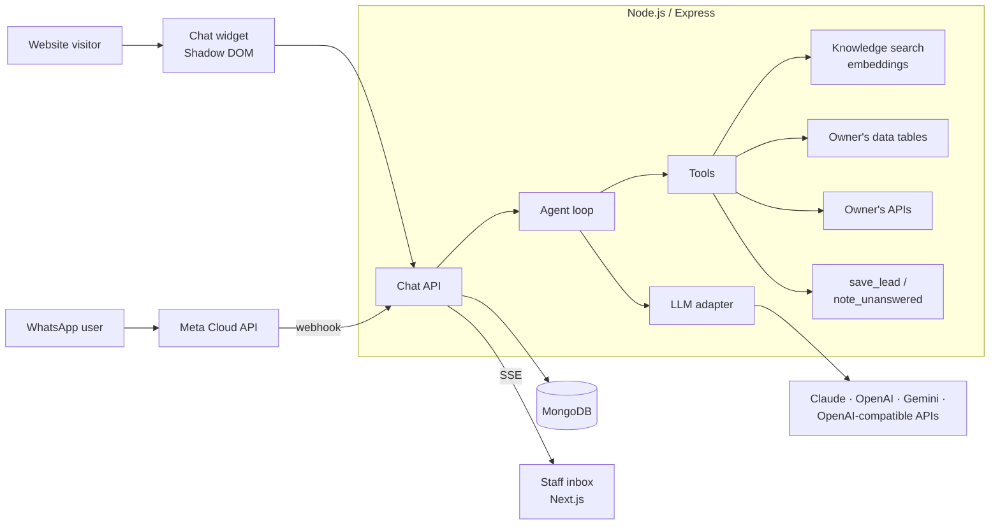

# Biz Smart: an AI assistant that answers your customers

It's 11:47 pm. A customer asks if you have a room on Friday. You're asleep. Biz Smart answers from your own prices, on your website and on WhatsApp, then tells you who to call back in the morning.

**Live:** [bizsmart.co.ke](https://bizsmart.co.ke)

> **This repo is a showcase.** Biz Smart is a commercial product, so the code is private. This page explains what it does and how it's built. I'm happy to walk through the code on a call.

## What it does

- **Answers from the business's own knowledge.** Owners upload PDFs and Word documents or point it at their website; it answers from that content.
- **Looks things up live.** Owners build tools without code: a *data table* tool searches a table they keep (rooms, packages, order status), and an *API tool* calls their own system with parameters the AI fills in.
- **Brings back leads.** When a customer wants a booking or a quote, it collects a name and phone number, saves the lead and emails the owner.
- **Learns what it doesn't know.** Questions it can't answer are collected (and counted when repeated). The owner answers once and it goes into the knowledge base.
- **Hands over to a human.** Staff see every conversation live in a shared inbox and can take over.
- **Works on the website and WhatsApp** with the same knowledge, tools and limits.

## Architecture

## Engineering highlights

- **Provider-agnostic agent loop.** One loop drives tool calling across Anthropic Claude, OpenAI, Google Gemini and OpenAI-compatible APIs (Groq, OpenRouter, Mistral). The platform admin switches model at runtime, with no restart; adding a compatible provider is one config entry.
- **Retrieval pipeline:** extraction from PDF, Word and scraped web pages, chunking, embeddings and search per tenant.
- **Multi-tenant SaaS:** platform admins, tenant owners and agents, each with their own sign-in and scope. Platform admins use TOTP two-factor authentication with recovery codes, and every admin change is audit-logged.
- **Safe owner-built tools:** API tools block private and internal addresses (SSRF protection), keep secret headers server-side, and can require a filter so visitors can't list a whole table.
- **Billing and limits:** monthly plans with message quotas, free trials, invoices paid by M-Pesa or card (IntaSend, verified with the provider before marking paid), grace periods and automatic pausing.
- **Cost tracking:** every AI answer records tokens and cost per day, tenant, model and channel; dashboards show spend trends, provider balances and how many days of credit are left.
- **Embeddable widget** rendered in a Shadow DOM so the host site's CSS and the widget can't break each other, themed with each business's brand colour.

## Stack

Node.js, Express, Next.js, React, MongoDB, Anthropic Claude / OpenAI / Google Gemini SDKs, embeddings-based retrieval, WhatsApp Cloud API, Server-Sent Events, IntaSend, M-Pesa Daraja, Resend.

---

Built by **Charles Njoroge** · [github.com/c-njoro](https://github.com/c-njoro) · [linkedin.com/in/charles-njoroge-dev](https://linkedin.com/in/charles-njoroge-dev)
